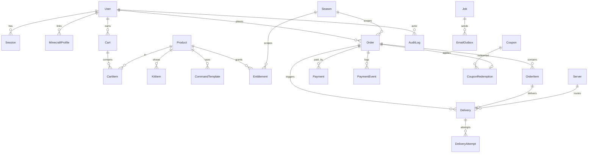

# Arsitektur CipiSMP Store

Dokumen ini menjelaskan keputusan teknis, struktur folder, model data, token desain, dan
peta fitur. Untuk daftar keputusan/penyimpangan dari brief, lihat `ASSUMPTIONS.md`.

## 1. Ringkasan

CipiSMP Store adalah aplikasi full-stack untuk menjual rank dan kit Minecraft yang
berlaku per season. Fokusnya bukan sekadar etalase: **uang, status pesanan, dan
pengiriman harus benar** bahkan saat gateway mengirim webhook ganda, server sedang
restart, atau pemain sedang offline.

Prinsip yang tidak pernah dilanggar:

1. **Harga dihitung server.** Klien hanya mengirim `productId`; total, diskon, pajak, dan
   biaya dihitung ulang dari database sebelum pembayaran dibuat.
2. **Status pesanan hanya berubah dari sumber tepercaya** — webhook bertanda tangan valid
   atau pemeriksaan status langsung ke gateway. Redirect tidak pernah menandai order lunas.
3. **Identitas adalah UUID**, bukan username. Username hanya tampilan dan disegarkan dari
   Mojang.
4. **Validitas = season.** Tidak ada expiry per pembelian, tidak ada renewal, semua
   entitlement gugur saat season berakhir.
5. **Tidak ada refund.** Tidak ada state `REFUNDED`, tidak ada pemanggilan refund gateway.
6. **Mutasi admin yang mengubah uang, akses, katalog, atau pengaturan diaudit** dengan
   nilai sebelum/sesudah dan IP; halaman baca serta pratinjau tidak dianggap sebagai mutasi.

## 2. Stack

| Lapisan | Pilihan | Catatan |
| --- | --- | --- |
| Framework | Next.js 15 (App Router), React 19, TypeScript strict | RSC untuk data, server action untuk mutasi |
| Database | PostgreSQL 16 | Uang `integer`, waktu `timestamptz`, enum native |
| ORM | **Drizzle ORM** + `pg` | Deviasi dari brief (Prisma) — lihat ASSUMPTIONS §1 |
| Migrasi | `drizzle-kit generate` + `drizzle-kit migrate` | SQL dapat direview di `src/server/db/migrations` |
| Auth | Implementasi sendiri (session cookie + argon2id + TOTP) | Deviasi dari "Auth.js/Lucia" — ASSUMPTIONS §2 |
| Styling | Tailwind CSS 3 + design token CSS variable | Radix primitives untuk aksesibilitas |
| Validasi | Zod (server & klien) | Satu skema dipakai ulang |
| Data klien | TanStack Query | Untuk polling status & PWA-free state |
| Antrean | Tabel `jobs` + `FOR UPDATE SKIP LOCKED` | Deviasi dari BullMQ — ASSUMPTIONS §3 |
| Cache/rate limit | Redis (opsional) dengan fallback in-memory | ASSUMPTIONS §4 |
| Email | Resend / SMTP / outbox (dev) | Semua lewat antrean |
| Pembayaran | Tripay, Midtrans, Fake (dev/test) | Adapter pattern |
| Test | Vitest (unit + integrasi DB), Playwright (e2e) | Integrasi memakai Postgres sungguhan |

## 3. Struktur folder

```
src/
  app/
    (store)/                 etalase publik: beranda, rank, kit, keranjang, checkout, legal
    (auth)/                  masuk, daftar, verifikasi email, reset password
    dashboard/               area pemain
    admin/                   panel staf
    api/                     status server, webhook gateway, plugin delivery, health
  components/
    ui/                      komponen dasar (button, field, dialog, tabs, ...)
    store/                   header, footer, kartu produk, panel status server
    admin/                   tabel & widget panel admin
    art/                     item art, badge rank, logo (SVG original)
  lib/                       logika murni & dipakai dua sisi
    pricing.ts               mesin harga (rank rules, kit limit, kupon, pajak, fee)
    order-state.ts           state machine order
    seasons.ts               freeze window, label masa aktif
    money.ts, dates.ts       format rupiah & WIB
  server/                    HANYA server: db, auth, payment, delivery, queue, email
  content/                   teks statis (FAQ)
  worker/                    proses worker antrean & job terjadwal
plugin/                      plugin Paper (Java) untuk pengiriman
docs/                        dokumentasi operasional & keputusan
```

Pemisahan penting: `src/lib` tidak boleh mengimpor `src/server` (agar bisa diuji murni),
dan komponen klien tidak boleh mengimpor modul server langsung.

## 4. Model data (ERD)



Detail penting:

- `Entitlement` unik pada `(uuid, productId, seasonId)`. Rank bersifat eksklusif per
  pemain/season: upgrade menonaktifkan entitlement lama lalu membuat yang baru.
- `Season` memiliki **unique index parsial** `WHERE status = 'ACTIVE'` sehingga database
  sendiri menolak dua season aktif.
- `PaymentEvent.dedupeKey` unik → webhook yang sama tidak pernah diproses dua kali.
- `Delivery.orderItemId` unik → satu item order hanya punya satu baris pengiriman.
- Semua tabel memakai `timestamptz`; API dan UI menampilkan Asia/Jakarta.

## 5. Alur pembayaran

```
Klien → POST /checkout (server action)
        1. validasi Zod
        2. muat ulang produk dari DB
        3. hitung ulang harga (priceCart)  ← abaikan total dari klien
        4. buat Order PENDING + OrderItem (snapshot harga & nama)
        5. adapter.createPayment() → providerRef, checkoutUrl
        6. redirect ke halaman pembayaran gateway

Gateway → POST /api/webhooks/{provider}
        1. verifikasi signature (HMAC / SHA512) → tolak bila invalid
        2. simpan PaymentEvent (raw payload + header) dengan dedupeKey
        3. dalam satu transaksi: kunci order, cek transisi state valid
        4. PAID → buat entitlement + Delivery QUEUED + job kirim email
        5. kasus tepi: DUPLICATE / UNDERPAID / OVERPAID / DISPUTED
```

State machine ada di `src/lib/order-state.ts` dan diuji di
`tests/unit/order-state.test.ts`. Transisi yang tidak ada di peta ditolak dengan
`InvalidOrderTransitionError`.

### Kasus tepi pembayaran

| Kasus | Perilaku |
| --- | --- |
| Webhook ganda | `dedupeKey` unik + cek status → tidak ada pengiriman kedua, `Payment.status = DUPLICATE`, notifikasi admin |
| Kurang bayar | Order tetap `PENDING`, `Payment.status = UNDERPAID`, admin dapat notifikasi untuk verifikasi manual |
| Lebih bayar | Dikirim sekali, kelebihan dicatat di `Payment.feeIdr`/catatan + notifikasi admin |
| Bayar setelah expired | `EXPIRED → PAID` diizinkan (dana sudah masuk), pengiriman tetap jalan |
| Chargeback | Order `DISPUTED`, admin memutuskan cabut entitlement / ban |
| Webhook telat | Job rekonsiliasi mengecek status langsung ke gateway |

## 6. Pengiriman item

Dua jalur, dipilih dari pengaturan server (`deliveryMode`):

1. **Plugin Paper** (`plugin/`) — plugin memulai koneksi keluar melalui HTTPS ke
   `POST /api/plugin/deliveries/poll`; website tidak membuka koneksi ke hosting Minecraft.
   Request poll, ACK, dan `/api/plugin/verify` memakai header `X-Cipi-Timestamp`,
   `X-Cipi-Nonce`, `X-Cipi-Signature` (HMAC-SHA256 atas `timestamp.nonce.body`). Server
   menolak timestamp dengan selisih > 5 menit, nonce yang pernah dipakai, dan signature
   salah. Claim dilakukan dalam transaksi dengan `SELECT ... FOR UPDATE SKIP LOCKED`;
   delivery menjadi `SENT` dengan lease 3 menit dan token unik. Plugin menjalankan perintah
   di main thread, menyimpan ID delivery yang telah dijalankan untuk mencegah eksekusi ganda
   saat ACK hilang, lalu mengirim token + hasil ke `POST /api/plugin/deliveries/ack`. ACK
   untuk lease yang sama idempoten; ACK lama ditolak setelah claim baru. Delivery pemain
   offline baru di-ACK setelah antrean lokal berhasil
   disimpan; antrean penuh atau gagal tulis disk menghasilkan kegagalan, bukan sukses palsu.
   ACK gagal atau lease kedaluwarsa dijadwalkan ulang dengan exponential backoff; setelah
   batas percobaan, delivery menjadi `DEAD` dan menimbulkan alert staf.
2. **RCON** — fallback; client RCON minimal ada di `src/server/delivery/rcon.ts`.

Webhook pembayaran tetap divalidasi website lebih dulu dan hanya membuat delivery `QUEUED`;
plugin tidak menerima webhook gateway. Worker tetap memproses job awal/retry RCON, sedangkan
mode plugin meninggalkan delivery di antrean database sampai plugin mengambilnya melalui poll.
Delivery permanen gagal muncul di `/admin/pengiriman` dengan tombol "Kirim ulang".

Urutan empat rank publik tidak bergantung pada nilai `products.sort_order`: Cute → Pop → Milk → Star.

## 7. Season

- `freezeStartsAt = endAt - freezeDays`, pembelian diblokir sejak waktu itu.
- Job transisi (idempoten): tandai season `ENDED`, aktifkan season berikutnya (bila ada),
  nonaktifkan semua entitlement season lama, antrekan perintah `REVOKE`, reset hitungan
  kit (otomatis karena entitlement baru per season), kirim ringkasan ke admin.
- Dry-run tersedia di `/admin/season/[id]/transisi` (menampilkan pemain & entitlement
  terdampak tanpa mengubah apa pun).

## 8. Keamanan

| Area | Implementasi |
| --- | --- |
| Session | Cookie httpOnly + Secure + SameSite=Lax, token 32 byte acak, disimpan sebagai SHA-256; rotasi saat login & 2FA; idle 120 menit, absolut 7 hari (30 hari bila "remember me") |
| Password | argon2id (19 MiB, t=2, p=1), kebijakan panjang & kerumitan, cek HIBP k-anonymity |
| 2FA | TOTP RFC 6238, anti-replay per time-step, wajib untuk staf |
| CSRF | Validasi Origin/Sec-Fetch-Site untuk semua mutasi + SameSite |
| CSP | Nonce per request di middleware, `frame-ancestors 'none'`, HSTS di produksi |
| Otorisasi | Cek role & permission di setiap halaman/aksi admin (`requireStaff(permission)`); query sensitif juga baru dijalankan untuk izin terkait, bukan hanya disembunyikan di UI |
| Minimisasi order | Lookup token publik hanya memilih ID; detail pembeli/admin memakai proyeksi per-tampilan, tanpa IP/UA, respons gateway mentah, metadata item penuh, atau perintah delivery. Panel admin juga tidak mengambil URL checkout/kode bayar; status/referensi yang dibutuhkan operasional tetap tersedia. |
| Rate limit | Auth, checkout, lookup username, webhook, plugin (Redis atau in-memory) |
| Webhook | Signature wajib, raw payload disimpan untuk pemrosesan/audit; panel admin hanya memilih ringkasan, tanpa raw payload/header/IP, `dedupeKey` unik |
| Plugin | HMAC + timestamp + nonce anti-replay |
| Secret | Kredensial gateway/RCON/TOTP dienkripsi AES-256-GCM |
| Audit | `audit_logs` untuk mutasi penting staf, termasuk comp grant, perubahan konfigurasi, dan transisi season |
| Header | CSP, HSTS, nosniff, Referrer-Policy, Permissions-Policy, X-Frame-Options |

## 9. Design token

Nilai ada di `src/app/globals.css` dan dipetakan ke Tailwind di `tailwind.config.ts`.

| Token | Nilai | Pemakaian |
| --- | --- | --- |
| `--bg` | `254 251 253` | latar utama putih hangat |
| `--surface` / `-2` / `-3` | `255 255 255` / `255 247 251` / `250 237 245` | kartu, panel, hover |
| `--line` / `-strong` | `237 226 234` / `215 196 208` | border 1px bernuansa rose |
| `--ink` | `52 39 50` | teks utama |
| `--muted` | `105 88 101` | teks sekunder |
| `--muted-2` | `137 119 133` | teks tersier |
| `--accent` / `--accent-strong` | `190 66 126` / `160 43 100` | CTA dan fokus; rose tua untuk teks |
| `--success` / `--danger` / `--info` | `42 117 82` / `164 49 62` / `57 101 139` | status saja |
| Badge rank | star `#f1c5dc`, milk `#fff8fc`, pop `#df8db5`, cute `#d5c3ed` | palet pink, putih, dan lavender |

Spasi berbasis kelipatan 4/8px, radius 6/10/14/20/28, transisi UI 150–250ms dan
interaksi 3D kartu 360–420ms dengan easing lembut. Marquee dua lajur dan kubus dekoratif
menggunakan CSS ringan; semua gerak dihentikan atau disederhanakan saat
`prefers-reduced-motion` aktif.

Tipografi: **Bricolage Grotesque** (display, OFL) + **Instrument Sans** (UI, OFL),
keduanya di-self-host lewat `@fontsource`. Data teknis memakai stack monospace sistem;
tidak ada permintaan font ke Google Fonts saat runtime.

## 10. Peta feature flag

Flag disimpan di `settings.features` dan dibaca dari server:

| Flag | Default | Isi |
| --- | --- | --- |
| `coupons` | aktif | kupon persen/nominal |
| `gifting` | aktif | hadiah ke pemain lain; entitlement diberikan ke penerima |
| `discordLogin` | **nonaktif** | OAuth Discord; perlu kredensial dan redirect URI publik |
| `reviews` | aktif | ulasan pembeli terverifikasi dengan moderasi staf |

Gifting dan ulasan sudah memiliki UI, aksi server, dan pengaturan admin. Login Discord
sudah terimplementasi tetapi tetap mati sampai konfigurasi OAuth disiapkan. Tiket dukungan,
bot, dan fitur lain di luar scope saat ini belum dibangun.

## 11. Job & proses

Worker (`npm run worker`) berjalan sebagai proses terpisah, menarik job dari tabel `jobs`
dengan `SKIP LOCKED` sehingga aman dijalankan lebih dari satu instance.

| Job | Pemicu | Sifat |
| --- | --- | --- |
| `email.send` | setelah email masuk outbox | retry 5x, backoff |
| `delivery.process` | order PAID | kirim ke plugin/RCON |
| `delivery.retry` | kegagalan sementara | backoff eksponensial |
| `order.expire` | cron tiap menit | PENDING → EXPIRED |
| `payment.reconcile` | cron tiap 5 menit | bandingkan order PENDING dengan gateway |
| `season.reminders` | cron harian | H-7 & H-1 |
| `season.transition` | cron tiap 10 menit | eksekusi saat endAt terlewati |

Selain worker, endpoint `POST /api/cron` (dengan header `Authorization: Bearer
$CRON_SECRET`) memicu siklus yang sama untuk deployment tanpa proses worker terpisah.
