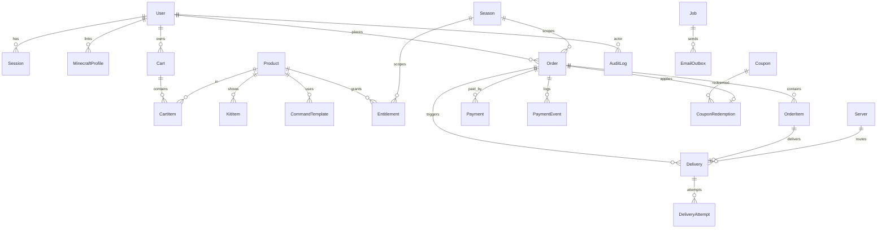

# Arsitektur CipiSMP Store

Dokumen ini menjelaskan keputusan teknis, struktur folder, model data, token desain, dan
peta fitur. Untuk daftar keputusan/penyimpangan dari brief, lihat `ASSUMPTIONS.md`.

## 1. Ringkasan

CipiSMP Store adalah aplikasi full-stack untuk menjual rank dan kit Minecraft yang
berlaku per season. Fokusnya bukan sekadar etalase: **uang, status pesanan, dan
pengiriman harus benar** bahkan saat gateway mengirim webhook ganda, server sedang
restart, atau pemain sedang offline.

Prinsip yang tidak pernah dilanggar:

1. **Harga dihitung server.** Klien hanya mengirim `productId`; total, diskon, pajak, dan
   biaya dihitung ulang dari database sebelum pembayaran dibuat.
2. **Status pesanan hanya berubah dari sumber tepercaya** — webhook bertanda tangan valid
   atau pemeriksaan status langsung ke gateway. Redirect tidak pernah menandai order lunas.
3. **Identitas adalah UUID**, bukan username. Username hanya tampilan dan disegarkan dari
   Mojang.
4. **Validitas = season.** Tidak ada expiry per pembelian, tidak ada renewal, semua
   entitlement gugur saat season berakhir.
5. **Tidak ada refund.** Tidak ada state `REFUNDED`, tidak ada pemanggilan refund gateway.
6. **Semua aksi admin diaudit** (sebelum/sesudah, alasan, IP, user agent).

## 2. Stack

| Lapisan | Pilihan | Catatan |
| --- | --- | --- |
| Framework | Next.js 15 (App Router), React 19, TypeScript strict | RSC untuk data, server action untuk mutasi |
| Database | PostgreSQL 16 | Uang `integer`, waktu `timestamptz`, enum native |
| ORM | **Drizzle ORM** + `pg` | Deviasi dari brief (Prisma) — lihat ASSUMPTIONS §1 |
| Migrasi | `drizzle-kit generate` + `drizzle-kit migrate` | SQL dapat direview di `src/server/db/migrations` |
| Auth | Implementasi sendiri (session cookie + argon2id + TOTP) | Deviasi dari "Auth.js/Lucia" — ASSUMPTIONS §2 |
| Styling | Tailwind CSS 3 + design token CSS variable | Radix primitives untuk aksesibilitas |
| Validasi | Zod (server & klien) | Satu skema dipakai ulang |
| Data klien | TanStack Query | Untuk polling status & PWA-free state |
| Antrean | Tabel `jobs` + `FOR UPDATE SKIP LOCKED` | Deviasi dari BullMQ — ASSUMPTIONS §3 |
| Cache/rate limit | Redis (opsional) dengan fallback in-memory | ASSUMPTIONS §4 |
| Email | Resend / SMTP / outbox (dev) | Semua lewat antrean |
| Pembayaran | Tripay, Midtrans, Fake (dev/test) | Adapter pattern |
| Test | Vitest (unit + integrasi DB), Playwright (e2e) | Integrasi memakai Postgres sungguhan |

## 3. Struktur folder

```
src/
  app/
    (store)/                 etalase publik: beranda, rank, kit, keranjang, checkout, legal
    (auth)/                  masuk, daftar, verifikasi email, reset password
    dashboard/               area pemain
    admin/                   panel staf
    api/                     status server, webhook gateway, plugin delivery, health
  components/
    ui/                      komponen dasar (button, field, dialog, tabs, ...)
    store/                   header, footer, kartu produk, panel status server
    admin/                   tabel & widget panel admin
    art/                     item art, badge rank, logo (SVG original)
  lib/                       logika murni & dipakai dua sisi
    pricing.ts               mesin harga (rank rules, kit limit, kupon, pajak, fee)
    order-state.ts           state machine order
    seasons.ts               freeze window, label masa aktif
    money.ts, dates.ts       format rupiah & WIB
  server/                    HANYA server: db, auth, payment, delivery, queue, email
  content/                   teks statis (FAQ)
  worker/                    proses worker antrean & job terjadwal
plugin/                      plugin Paper (Java) untuk pengiriman
docs/                        dokumentasi operasional & keputusan
```

Pemisahan penting: `src/lib` tidak boleh mengimpor `src/server` (agar bisa diuji murni),
dan komponen klien tidak boleh mengimpor modul server langsung.

## 4. Model data (ERD)



Detail penting:

- `Entitlement` unik pada `(uuid, productId, seasonId)`. Rank bersifat eksklusif per
  pemain/season: upgrade menonaktifkan entitlement lama lalu membuat yang baru.
- `Season` memiliki **unique index parsial** `WHERE status = 'ACTIVE'` sehingga database
  sendiri menolak dua season aktif.
- `PaymentEvent.dedupeKey` unik → webhook yang sama tidak pernah diproses dua kali.
- `Delivery.orderItemId` unik → satu item order hanya punya satu baris pengiriman.
- Semua tabel memakai `timestamptz`; API dan UI menampilkan Asia/Jakarta.

## 5. Alur pembayaran

```
Klien → POST /checkout (server action)
        1. validasi Zod
        2. muat ulang produk dari DB
        3. hitung ulang harga (priceCart)  ← abaikan total dari klien
        4. buat Order PENDING + OrderItem (snapshot harga & nama)
        5. adapter.createPayment() → providerRef, checkoutUrl
        6. redirect ke halaman pembayaran gateway

Gateway → POST /api/webhooks/{provider}
        1. verifikasi signature (HMAC / SHA512) → tolak bila invalid
        2. simpan PaymentEvent (raw payload + header) dengan dedupeKey
        3. dalam satu transaksi: kunci order, cek transisi state valid
        4. PAID → buat entitlement + Delivery QUEUED + job kirim email
        5. kasus tepi: DUPLICATE / UNDERPAID / OVERPAID / DISPUTED
```

State machine ada di `src/lib/order-state.ts` dan diuji di
`tests/unit/order-state.test.ts`. Transisi yang tidak ada di peta ditolak dengan
`InvalidOrderTransitionError`.

### Kasus tepi pembayaran

| Kasus | Perilaku |
| --- | --- |
| Webhook ganda | `dedupeKey` unik + cek status → tidak ada pengiriman kedua, `Payment.status = DUPLICATE`, notifikasi admin |
| Kurang bayar | Order tetap `PENDING`, `Payment.status = UNDERPAID`, admin dapat notifikasi untuk verifikasi manual |
| Lebih bayar | Dikirim sekali, kelebihan dicatat di `Payment.feeIdr`/catatan + notifikasi admin |
| Bayar setelah expired | `EXPIRED → PAID` diizinkan (dana sudah masuk), pengiriman tetap jalan |
| Chargeback | Order `DISPUTED`, admin memutuskan cabut entitlement / ban |
| Webhook telat | Job rekonsiliasi mengecek status langsung ke gateway |

## 6. Pengiriman item

Dua jalur, dipilih dari pengaturan server (`deliveryMode`):

1. **Plugin Paper** (`plugin/`) — store mengirim `POST /cipismp/deliver` dengan header
   `X-Cipi-Timestamp`, `X-Cipi-Nonce`, `X-Cipi-Signature` (HMAC-SHA256 atas
   `timestamp.nonce.body`). Plugin menolak timestamp > 5 menit, nonce yang pernah dipakai,
   dan signature salah. Plugin menyimpan antrean ke `plugins/CipiSMPStore/queue.json`
   sehingga perintah tidak hilang saat restart, lalu meng-ACK setelah semua perintah
   dieksekusi. Endpoint `POST /api/plugin/deliveries/{id}/ack` menerima ACK.
2. **RCON** — fallback untuk setup sederhana; client RCON minimal ada di
   `src/server/delivery/rcon.ts`.

Retry memakai backoff eksponensial (job queue), kegagalan permanen masuk dead-letter dan
muncul di `/admin/pengiriman` dengan tombol "Kirim ulang".

## 7. Season

- `freezeStartsAt = endAt - freezeDays`, pembelian diblokir sejak waktu itu.
- Job transisi (idempoten): tandai season `ENDED`, aktifkan season berikutnya (bila ada),
  nonaktifkan semua entitlement season lama, antrekan perintah `REVOKE`, reset hitungan
  kit (otomatis karena entitlement baru per season), kirim ringkasan ke admin.
- Dry-run tersedia di `/admin/season/[id]/transisi` (menampilkan pemain & entitlement
  terdampak tanpa mengubah apa pun).

## 8. Keamanan

| Area | Implementasi |
| --- | --- |
| Session | Cookie httpOnly + Secure + SameSite=Lax, token 32 byte acak, disimpan sebagai SHA-256; rotasi saat login & 2FA; idle 120 menit, absolut 7 hari (30 hari bila "remember me") |
| Password | argon2id (19 MiB, t=2, p=1), kebijakan panjang & kerumitan, cek HIBP k-anonymity |
| 2FA | TOTP RFC 6238, anti-replay per time-step, wajib untuk staf |
| CSRF | Validasi Origin/Sec-Fetch-Site untuk semua mutasi + SameSite |
| CSP | Nonce per request di middleware, `frame-ancestors 'none'`, HSTS di produksi |
| Otorisasi | Cek role & permission di setiap halaman/aksi admin (`requireStaff(permission)`) — bukan hanya menyembunyikan UI |
| Rate limit | Auth, checkout, lookup username, webhook, plugin (Redis atau in-memory) |
| Webhook | Signature wajib, raw payload disimpan, `dedupeKey` unik |
| Plugin | HMAC + timestamp + nonce anti-replay |
| Secret | Kredensial gateway/RCON/TOTP dienkripsi AES-256-GCM |
| Audit | `audit_logs` untuk semua aksi staf, termasuk comp grant & perubahan pengaturan |
| Header | CSP, HSTS, nosniff, Referrer-Policy, Permissions-Policy, X-Frame-Options |

## 9. Design token

Nilai ada di `src/app/globals.css` dan dipetakan ke Tailwind di `tailwind.config.ts`.

| Token | Nilai | Pemakaian |
| --- | --- | --- |
| `--bg` | `14 13 11` | latar utama |
| `--surface` / `-2` / `-3` | `21 19 15` / `28 25 21` / `36 32 26` | kartu, panel, hover |
| `--line` / `-strong` | `45 40 33` / `60 53 43` | border 1px |
| `--ink` | `242 236 225` | teks utama (kontras 12.9:1 di bg) |
| `--muted` | `166 158 143` | teks sekunder (kontras 6.8:1) |
| `--muted-2` | `125 118 106` | teks tersier (kontras 3.9:1, hanya untuk label besar) |
| `--accent` | `224 168 78` | CTA, fokus, aksen tunggal |
| `--success` / `--danger` / `--info` | hijau/merah/biru redup | status saja |
| Tier | star `246 207 95`, milk `229 241 237`, pop `255 152 124`, cute `239 154 214` | badge rank |

Spasi kelipatan 8px (`4`, `8`, `12`, ...), radius 6/10/14/20/28, durasi transisi
150–250ms dengan easing `cubic-bezier(0.22, 1, 0.36, 1)`. Semua animasi dimatikan pada
`prefers-reduced-motion`.

Tipografi: **Bricolage Grotesque** (display, OFL) + **Instrument Sans** (UI, OFL) +
**Silkscreen** (aksen piksel hanya di logo/eyebrow, OFL). Semua di-self-host lewat
`@fontsource`, jadi tidak ada permintaan ke Google Fonts.

## 10. Peta feature flag

Flag disimpan di `settings.features` dan dibaca dari server:

| Flag | Default | Isi |
| --- | --- | --- |
| `coupons` | aktif | kupon persen/nominal |
| `gifting` | **nonaktif** | hadiah ke pemain lain (aturan harga sudah ada di mesin harga) |
| `discordLogin` | **nonaktif** | OAuth Discord (Wave 2) |
| `reviews` | **nonaktif** | ulasan terverifikasi (Wave 3) |

Fitur Wave 2/3 tidak diimplementasikan di MVP, tetapi titik ekstensinya disiapkan
(adapter pembayaran baru, `targetUuid` pada keranjang, tipe job baru).

## 11. Job & proses

Worker (`npm run worker`) berjalan sebagai proses terpisah, menarik job dari tabel `jobs`
dengan `SKIP LOCKED` sehingga aman dijalankan lebih dari satu instance.

| Job | Pemicu | Sifat |
| --- | --- | --- |
| `email.send` | setelah email masuk outbox | retry 5x, backoff |
| `delivery.process` | order PAID | kirim ke plugin/RCON |
| `delivery.retry` | kegagalan sementara | backoff eksponensial |
| `order.expire` | cron tiap menit | PENDING → EXPIRED |
| `payment.reconcile` | cron tiap 5 menit | bandingkan order PENDING dengan gateway |
| `season.reminders` | cron harian | H-7 & H-1 |
| `season.transition` | cron tiap 10 menit | eksekusi saat endAt terlewati |

Selain worker, endpoint `POST /api/cron` (dengan header `Authorization: Bearer
$CRON_SECRET`) memicu siklus yang sama untuk deployment tanpa proses worker terpisah.
